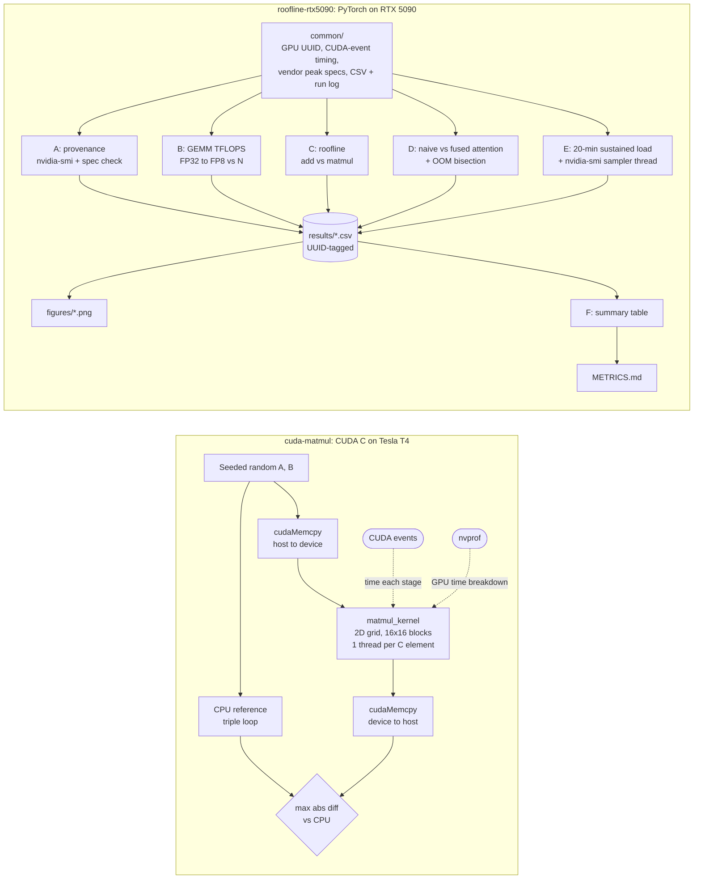

# GPU Performance Benchmarking

Measuring how fast GPU code really runs, and why: a hand-written CUDA C kernel profiled with nvprof,
and a roofline / precision / attention / thermal study of an NVIDIA RTX 5090 in PyTorch.

| Study | Hardware | Headline result |
|---|---|---|
| [CUDA C matrix multiply](cuda-matmul/) | Tesla T4 | **1,527x** faster than a CPU loop at N=4096 (end-to-end, including transfers) |
| [Roofline model](roofline-rtx5090/METRICS.md#part-c--memory-bound-vs-compute-bound-roofline) | RTX 5090 | FP32 ridge point **58.5 FLOPs/byte**; streaming add at **1,564 GB/s** (87% of spec) |
| [GEMM throughput by precision](roofline-rtx5090/METRICS.md#part-b--matmul-throughput-vs-n-and-precision) | RTX 5090 | FP32 64, TF32 113, FP16 225, BF16 229, FP8 **448 TFLOPS** |
| [Naive vs. fused attention](roofline-rtx5090/METRICS.md#part-d--naive-vs-fused-attention) | RTX 5090 | Fused SDPA up to **7.2x** faster; naive attention OOMs at **22,438** tokens (bisected) |
| [Sustained load](roofline-rtx5090/METRICS.md#part-e--sustained-load-20-min-bf16-matmul) | RTX 5090 | **97.6%** of peak after 20 min, no throttling |

## What this project does

A GPU's spec sheet gives one peak number. Real kernels land somewhere below it, and the gap is set by
how the kernel uses the hardware. This repo measures that gap and explains it in two parts.

1. **CUDA C from scratch (Tesla T4).** A matrix multiply written by hand in CUDA C (one GPU thread per
   output element) is checked against a plain CPU loop. Kernel time and host/device copy time are
   measured separately, and nvprof shows where GPU time goes. Result: the GPU wins from N=256 up, and
   by **1,527x** at N=4096.
2. **How close does a real GPU get to its peak? (RTX 5090, PyTorch).** Five experiments on one card:
   - **Precision:** matmul TFLOPS for FP32, TF32, FP16, BF16 and FP8 as the matrix grows, until each
     one stops getting faster (plateaus).
   - **Roofline:** is a kernel limited by memory bandwidth or by compute? A streaming add (0.083
     FLOPs/byte) and a large matmul (1,365 FLOPs/byte) sit on opposite sides of the ridge point.
   - **Attention:** naive attention stores the full seq x seq score matrix, so its memory grows as
     seq². Fused attention (PyTorch `scaled_dot_product_attention`) never stores that matrix. The test
     measures the speed difference and finds the exact sequence length where naive attention runs out
     of memory.
   - **Sustained load:** 20 minutes of BF16 matmul with clocks, power, temperature and throttle flags
     sampled every 5 s.
   - **Provenance:** every result row is tagged with the GPU's UUID, and the vendor peak numbers are
     cross-checked against the NVIDIA whitepaper.

### The roofline in one line

```
attainable FLOP/s = min( peak compute ,  arithmetic intensity (FLOPs/byte) x memory bandwidth )
```

On the RTX 5090 (FP32: 104.8 TFLOPS, 1,792 GB/s) the two limits cross at **58.5 FLOPs/byte**. A kernel
with lower intensity than that is limited by memory bandwidth, and one with higher intensity is limited
by compute.

## Architecture



**How one measurement is taken (PyTorch suite):** warm up with untimed runs, then run several trials.
Each trial records a CUDA event, runs the operation many times back to back, records a second event and
synchronizes once. The per-trial averages give the reported mean, median and spread, so CPU launch
jitter inside the loop doesn't inflate the variance. GEMM and roofline use 10 warm-up runs and 5 trials
of 20 runs; attention uses 5 warm-up runs and 3 trials of 10. Each result is appended as a CSV row
with the GPU UUID and logged to `RUN_LOG.txt`.

**How the OOM boundary is found (Part D):** sweep sequence lengths until naive attention fails, then
bisect between the last length that worked and the first that failed, down to a single token
(22,437 works, 22,438 runs out of memory). The result is checked against the measured memory curve,
64 bytes per token².

## Layout

```
cuda-matmul/        matmul.cu (CUDA C kernel + CPU reference), cuda.ipynb (Colab run with nvprof), RESULTS.md
roofline-rtx5090/   PyTorch benchmark suite, results/ CSVs, figures/, METRICS.md
  common/             GPU identity, CUDA-event timing, CSV and run-log helpers, vendor peak specs
  part_a_provenance/  nvidia-smi capture and spec cross-check
  part_b_precision/   matmul TFLOPS vs. N for FP32 / TF32 / FP16 / BF16 / FP8
  part_c_bandwidth_compute/  memory-bound vs. compute-bound kernels on the roofline
  part_d_attention/   naive vs. fused attention, OOM boundary bisection, memory scaling
  part_e_thermal/     20-minute sustained load with clocks, power and throttle flags
  part_f_analysis/    summary table builder
```

## Running

**CUDA matmul** (any NVIDIA GPU with nvcc):

```bash
cd cuda-matmul
nvcc -O3 matmul.cu -o matmul
./matmul 1024            # N defaults to 256
nvprof ./matmul 1024     # or: nsys profile ./matmul 1024
```

**RTX 5090 suite** (PyTorch with CUDA):

```bash
cd roofline-rtx5090
pip install -r requirements.txt
bash run_all.sh          # read it first: Part E runs for 20 minutes and Part D OOMs on purpose
```

Every CSV row and run-log line is tagged with the GPU UUID, so results from different cards can be merged.

## Notes

- **Timing:** warm-up first, then CUDA events around batches of repetitions, over several trials, so
  per-iteration dispatch jitter does not inflate the variance.
- **TF32** is a compute mode on FP32 tensors (`torch.backends.cuda.matmul.allow_tf32`), not a storage type.
- **Above 100% of peak:** vendor peaks use the ~2.41 GHz boost clock; the card ran at 2,835-2,857 MHz
  under load, so 105-109% of the spec-sheet number is expected.
- **Roofline:** the matmul arithmetic intensity assumes each of A, B and C crosses DRAM once (a lower
  bound that ignores on-chip reuse). It grows with N; the elementwise kernel's stays flat.
- **WSL2 caveat:** the Windows driver silently spills over-capacity allocations to host RAM instead of
  raising OOM (57 ms -> 1,670 ms), so the OOM boundary was measured with PyTorch capped to free VRAM
  (`run_d_capped.py`).

## How this was built

Started as GPU coursework for SJSU DATA266 (Fall 2026). The PyTorch benchmark harness was drafted with
Claude Code; I ran everything on the hardware, checked the vendor specs, debugged the WSL2 memory
fallback, and wrote the analysis in `METRICS.md`.

## License

MIT
